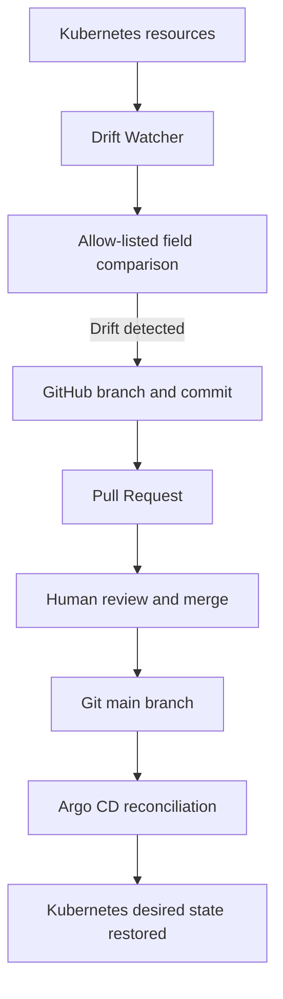

# Kubernetes GitOps Drift Watcher

## Overview

The GitOps Drift Watcher is a Python-based service that monitors explicitly allow-listed Kubernetes resource fields and proposes Git changes through automated GitHub Pull Requests.

Instead of modifying the Git repository directly, the watcher creates a branch, commits the proposed manifest change, and opens a Pull Request for review. Argo CD remains responsible for reconciling the cluster with the desired state defined in Git.

This project was built as a hands-on DevOps and DevSecOps lab.

## Architecture



## Technology Stack

- Kubernetes
- Python
- Docker
- Git and GitHub
- GitHub Actions
- GitHub Container Registry (GHCR)
- Argo CD
- Kubernetes RBAC
- Sealed Secrets

## Monitored Resources

The monitoring policy is defined in `.github/scripts/drift-watch-policy.yaml`.

| Resource | Namespace | Monitored field | Manifest |
|---|---|---|---|
| ConfigMap `drift-lab` | `default` | `data.mode` | `k8s/drift-lab.yaml` |
| Deployment `replicas-lab` | `default` | `spec.replicas` | `k8s/replicas-lab.yaml` |

Only explicitly configured fields are evaluated for drift. The watcher does not automatically propose changes to every field in a Kubernetes resource.

## Drift Detection Workflow

1. The watcher subscribes to Kubernetes resource watch events.
2. It filters events to the configured resource names and namespaces.
3. It compares the allow-listed live field values with the corresponding manifests from Git.
4. When a difference is detected, it creates a new Git branch.
5. It updates only the approved manifest field and commits the change.
6. It pushes the branch and opens a GitHub Pull Request.
7. A reviewer inspects and merges the Pull Request.
8. Argo CD reconciles the cluster according to the GitOps configuration.

The watcher does not directly patch Kubernetes resources to restore their state, and it does not commit directly to `main`.

## Runtime and Security

The watcher runs as a Kubernetes Deployment in the `drift-watcher` namespace.

Security-related controls include:

- A dedicated Kubernetes ServiceAccount.
- Namespace-scoped Role and RoleBinding permissions for the two monitored resources.
- Read-only root filesystem.
- Non-root container execution.
- Dropped Linux capabilities and `RuntimeDefault` seccomp profile.
- CPU, memory, and ephemeral-storage requests and limits.
- A container image pinned by SHA-256 digest.
- A GitHub token injected from a Kubernetes Secret generated through Sealed Secrets.

The watcher requires GitHub permissions to push branches and open Pull Requests. Its Kubernetes RBAC permissions are separate from its GitHub permissions.

## Container Image

The image is built and published through GitHub Actions to GitHub Container Registry.

The Kubernetes manifest uses an immutable image reference pinned by digest rather than relying on a mutable `latest` tag.

Image publishing workflow:

`.github/workflows/drift-watcher-image.yml`

Deployment manifest:

`k8s/drift-watcher-deployment.yaml`

## Validation Results

The lab was tested against two deliberate drift scenarios.

### Scenario 1: ConfigMap data drift

The live `data.mode` value was changed from `v2-test` to `v3-test`.

The watcher detected the difference and opened [Pull Request #47](https://github.com/saeed0000000/project-lab/pull/47). The proposed change was reviewed and merged.

### Scenario 2: Deployment replica drift

The live replica count was changed from `2` to `3`.

The watcher detected the difference in `spec.replicas` and opened [Pull Request #48](https://github.com/saeed0000000/project-lab/pull/48). The proposed change was reviewed and merged.

The project also verified that the watcher could read and watch the allow-listed resources while lacking permission to patch the Deployment directly.

### Important HPA and Argo CD behavior

The replica-count scenario is subject to the cluster's Horizontal Pod Autoscaler and the Argo CD configuration for `spec.replicas`. When that field is configured to be ignored during reconciliation, the live replica count may differ from the manifest without causing Argo CD to overwrite it.

Therefore, the successful drift detection and Pull Request creation are distinct from the final replica count chosen by the autoscaling configuration.

## Repository Map

```text
.github/
  scripts/
    drift-pr-watcher.py
    drift-watch-policy.yaml
    tests/
  workflows/
    drift-watcher-image.yml

drift-watcher/
  Dockerfile
  entrypoint.sh

k8s/
  drift-lab.yaml
  replicas-lab.yaml
  drift-watcher-rbac.yaml
  drift-watcher-github-sealedsecret.yaml
  drift-watcher-deployment.yaml

docs/
  drift-watcher-architecture.md
```

## Reproducing the ConfigMap Drift Test

Prerequisites:

- `kubectl` configured for the test cluster.
- The watcher Deployment running.
- GitHub credentials already configured for the watcher.
- The Argo CD application synchronized with the repository.

Check the current value:

```bash
kubectl -n default get configmap drift-lab \
  -o jsonpath='{.data.mode}{"\n"}'
```

Watch the watcher logs:

```bash
kubectl -n drift-watcher logs \
  -f deployment/drift-watcher --since=1m
```

In a second terminal, introduce a deliberate change:

```bash
kubectl -n default patch configmap drift-lab \
  --type=merge \
  -p '{"data":{"mode":"v4-test"}}'
```

Verify that the watcher detects the drift and opens a Pull Request. Inspect the manifest diff and CI checks before merging.

After merging, verify Argo CD health and the live value:

```bash
kubectl -n argocd get application project-app

kubectl -n default get configmap drift-lab \
  -o jsonpath='{.data.mode}{"\n"}'
```

The expected final value is the value merged into Git, provided no other controller or reconciliation rule intentionally manages that field.

## Limitations and Future Improvements

- Add structured logs and application health metrics.
- Add tests for GitHub API failures, Kubernetes watch reconnects, and duplicate Pull Request handling.
- Improve alerting when a Pull Request cannot be created.
- Document token rotation and least-privilege GitHub permissions.
- Add further allow-listed resource types only after defining and testing their update policies.

## Portfolio Note

This project demonstrates practical experience with Kubernetes API watches, RBAC, container hardening, immutable image references, GitHub automation, and GitOps reconciliation through Argo CD.
